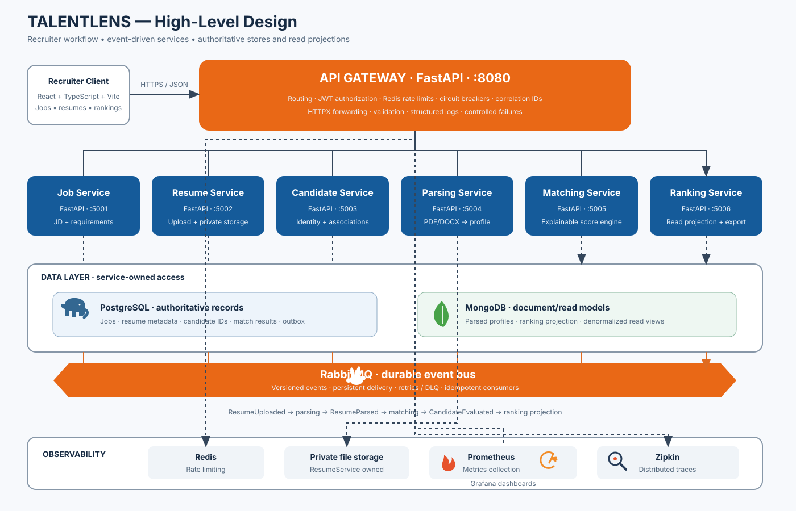
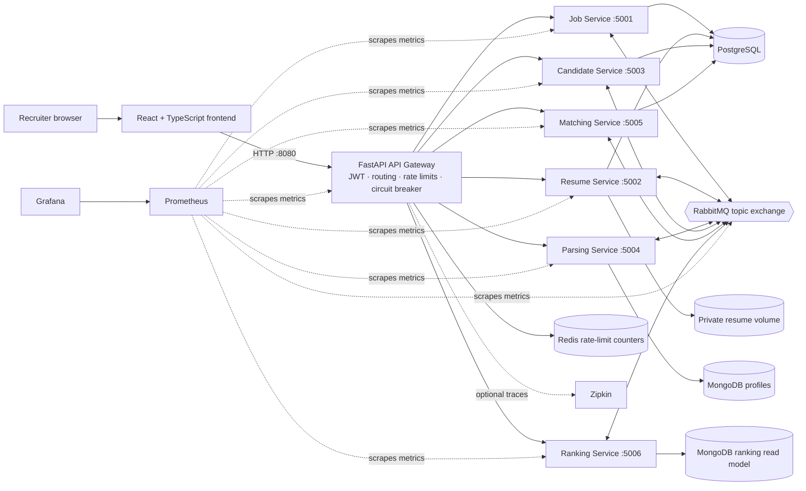
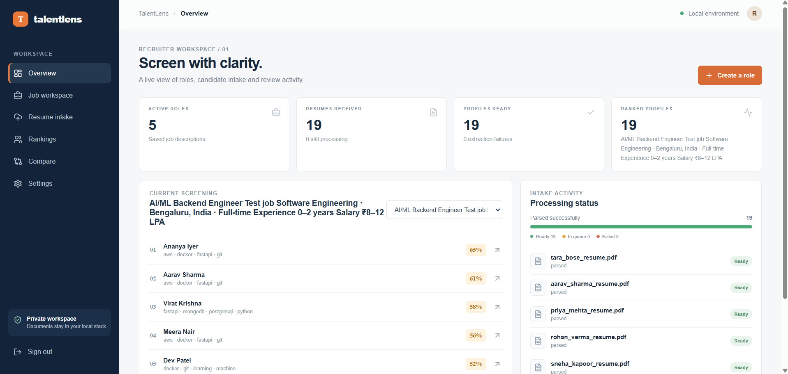
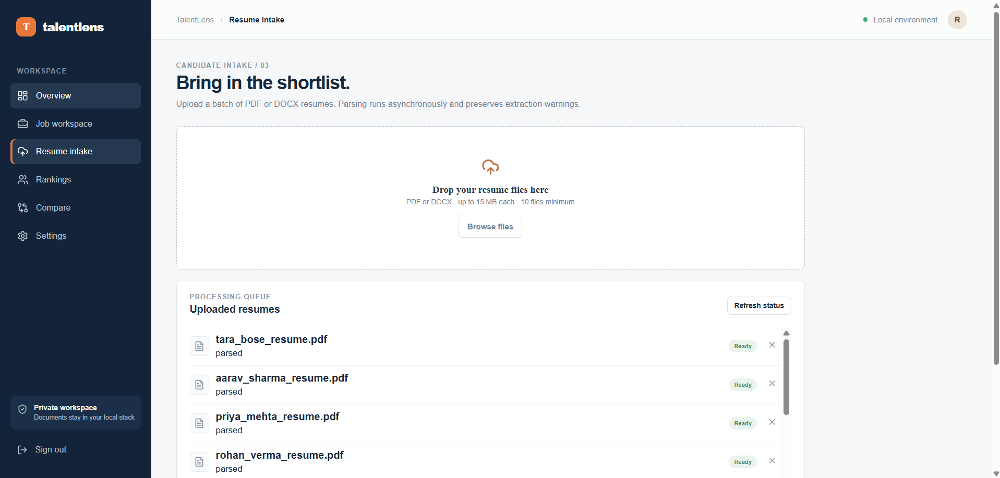
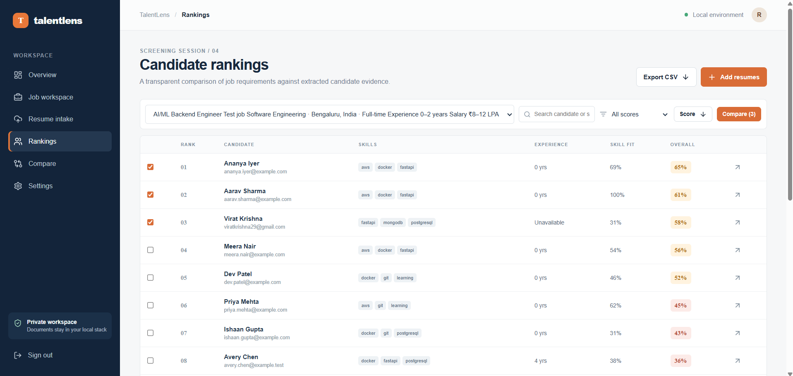
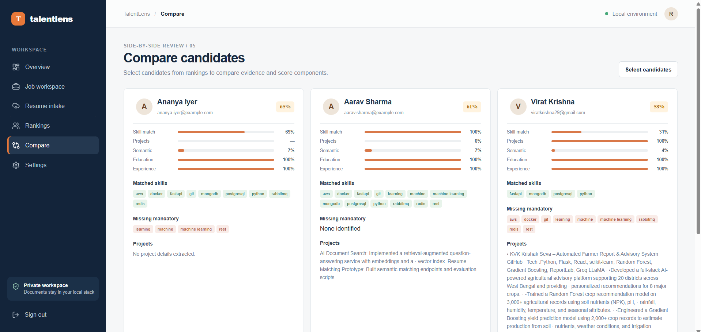
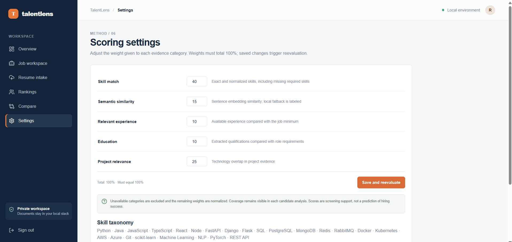
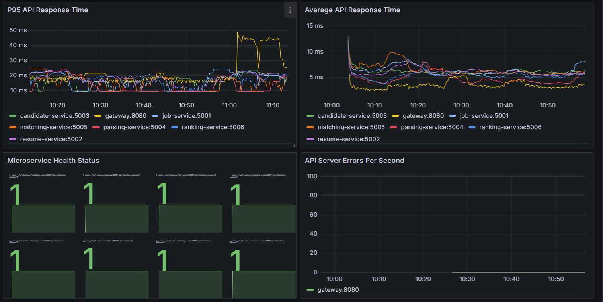
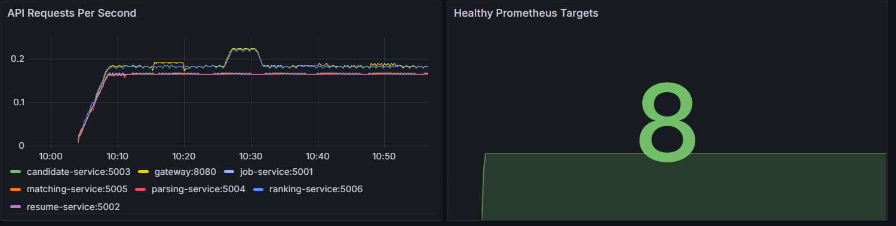

# TalentLens — AI Resume Matching & Ranking

TalentLens is a local recruiter workspace prototype for comparing candidate resumes with a job description (JD). A recruiter creates a role, uploads a batch of PDF/DOCX resumes, follows asynchronous parsing, reviews evidence-backed candidate matches, ranks and compares candidates, and exports results.

> TalentLens provides screening support. A score is a comparison of extracted evidence against one role; it is not a prediction of hiring success or a hiring decision. Recruiters must review the source documents and make decisions themselves.

## Assignment coverage

| Requirement | TalentLens implementation |
|---|---|
| Enter or upload a JD | React job workspace; paste text or upload TXT, PDF, or DOCX; extract and edit structured requirements |
| Upload at least 10 resumes | Batch upload accepts 10–100 PDF/DOCX files; validates file type/size and detects duplicates by SHA-256 |
| Extract candidate information | Async PDF/DOCX extraction, candidate/profile fields, skills, experience, education, projects, and extraction warnings |
| Match each resume with the JD | Weighted skill, semantic, experience, education, and project components; matched/missing evidence and explanations |
| Rank and inspect candidates | Searchable/sortable rankings, candidate-level analysis, shortlist comparison, CSV export |
| Explain score methodology | [Scoring method](docs/matching-method.md), configurable weights, component breakdown and coverage |

All included example resumes are synthetic. Do not put real candidate information in this demo repository or use it for actual hiring decisions.

## High-level architecture



The React frontend talks to the API Gateway. The gateway authenticates recruiter requests and routes them to six internal FastAPI services. Services own their records and communicate asynchronously through RabbitMQ events. PostgreSQL is the source of truth for jobs, upload metadata, candidate IDs and match results. MongoDB stores parsed profile documents and the query-optimized ranking projection. Redis stores rate-limit counters. Uploaded files stay in a private Docker volume.



## Application screenshots

Screenshots below show the local prototype using sample data. The overview shows completed parsing and ranking activity; the intake view shows parsed resumes ready for review.

### Recruiter workflow

**Workspace overview**



**Resume intake**



**Candidate rankings**



**Side-by-side candidate comparison**



**Configurable scoring weights**



### Monitoring screenshots

**Grafana latency and service health panels**



**Grafana request rate and Prometheus target health**



The monitoring charts show activity from this local demo and are illustrative; they are not production load-test results.

### Services and local ports

| Component | Port | Responsibility / data |
|---|---:|---|
| Frontend | 5173 | Recruiter UI: jobs, intake, rankings, comparison, settings |
| API Gateway | 8080 | JWT auth, routing, Redis rate limiting, correlation IDs, circuit breaker, metrics; optional Zipkin tracing |
| Job Service | 5001 (internal) | JD CRUD and structured job requirements; PostgreSQL |
| Resume Service | 5002 (internal) | Batch validation, SHA-256 duplicate detection, upload status and private file storage; PostgreSQL + volume |
| Candidate Service | 5003 (internal) | Candidate identity and resume association; PostgreSQL |
| Parsing Service | 5004 (internal) | PDF/DOCX text and profile extraction; MongoDB |
| Matching Service | 5005 (internal) | JD/profile evaluation and authoritative score records; PostgreSQL |
| Ranking Service | 5006 (internal) | Search, sorting, candidate analysis and ranking projection; MongoDB |
| PostgreSQL | 5432 | Authoritative relational data and outbox records |
| MongoDB | 27017 | Parsed profiles and ranking read model |
| RabbitMQ | 5672 / 15672 | Event transport / management interface |
| Redis | 6379 | Gateway rate-limit counters |
| Prometheus (monitoring profile) | 9090 | Scrapes service and RabbitMQ metrics every 15 seconds |
| Grafana (monitoring profile) | 3000 | Prometheus data source; explore metrics or create dashboards |
| Zipkin (monitoring profile) | 9411 | Distributed trace UI; gateway tracing is opt-in |

Only the frontend and gateway are used by the browser for application traffic. Service ports are internal to the Docker network. Data-store and monitoring ports are published for local development.

## End-to-end application flow

1. **Create a role.** The recruiter pastes or uploads a JD. Job Service extracts a first draft of skills, qualifications, experience and other requirements; the recruiter can edit the requirements before saving. Job Service stores the role in PostgreSQL and publishes job lifecycle events through its outbox.
2. **Upload a resume batch.** The recruiter selects 10–100 PDF/DOCX files. Resume Service validates the batch, applies size limits, hashes each file for duplicate detection, saves files in a private volume, and records queued status in PostgreSQL.
3. **Publish upload events.** The resume metadata and outbox event are written in the same database transaction. A publisher sends `ResumeUploaded` to the durable `talentlens.events.v1` RabbitMQ topic exchange. Resume bytes are not sent through RabbitMQ.
4. **Parse asynchronously.** Parsing Service consumes the event, reads the private file, extracts text and profile information, stores the profile in MongoDB, updates parsing status, and emits `ResumeParsed` with warnings as appropriate.
5. **Build candidate and match records.** Candidate Service consumes `ResumeParsed` to create the candidate identity. Matching Service consumes parsed-profile and job events, evaluates each candidate against each relevant role, and stores the authoritative result in PostgreSQL.
6. **Update rankings.** Matching Service publishes `CandidateEvaluated`; Ranking Service consumes it and replaces that job/candidate entry in the MongoDB ranking projection. The UI reads the projection. A short delay between a score being saved and appearing in rankings is expected because this is an eventually consistent asynchronous workflow.
7. **Review results.** The recruiter opens a candidate analysis to see extracted fields, warnings, component scores, matched/missing skills, experience comparison, score coverage and explanation. Candidates can be compared and rankings exported as CSV.

Events are versioned and persistent, and include an event ID, type, timestamp, optional correlation ID and payload. Consumers retry callback failures up to three times and then dead-letter messages. Consumers use event IDs for idempotency where records are mutated. See [event flow](docs/event-flow.md) and [data ownership](docs/data-ownership.md) for details.

## Matching and score methodology

The default weights for a fresh local database are:

```text
Overall = 0.40 × Skills
        + 0.25 × Semantic similarity
        + 0.20 × Relevant experience
        + 0.10 × Education
        + 0.05 × Project relevance
```

Each available component is scored from 0 to 100. If a component cannot be computed because the source resume lacks evidence, that component is omitted and the remaining weights are normalized to total 100%. The result reports **coverage** (the share of original weight that was available) and missing components; missing evidence is not silently treated as a zero. Recruiters can adjust weights in Settings; saved weights trigger reevaluation.

- **Skills:** normalized exact matches, with required skills weighted more than preferred skills. Aliases such as `React.js` and `React` normalize together. Related skills are shown as context, not counted as exact matches.
- **Semantic similarity:** compares the JD summary with extracted role/project evidence. The Docker demo currently uses a deterministic TF-IDF cosine fallback and labels the method in the result. Sentence Transformers `all-MiniLM-L6-v2` is an optional code path when the model and dependency are available in a non-container environment; it is not the Docker demo's active scorer.
- **Experience:** estimates duration from extracted employment date ranges, unions overlapping ranges to avoid double counting, and compares available years with the job's minimum experience.
- **Education:** compares extracted qualifications against the role requirements.
- **Project relevance:** compares project evidence with role skills and requirements.

For the exact formula, assumptions and worked example see [docs/matching-method.md](docs/matching-method.md). Scores are deterministic for equivalent inputs and runtime configuration. They are decision support, not a prediction of candidate performance.

## Run locally with Docker Desktop

### Prerequisites

- Windows, macOS or Linux with Docker Desktop/Engine and Docker Compose v2.
- 8 GB RAM recommended for building and running the complete stack.
- A modern browser.

### Start the application and monitoring tools

Open the project folder in VS Code, then open **Terminal → New Terminal** (PowerShell on Windows). Run these commands from the repository root:

```powershell
Copy-Item .env.example .env
docker compose --profile monitoring up --build -d
docker compose --profile monitoring ps
```

The first build can take several minutes, depending on network speed and whether Docker already has the base images. Wait for the application services to show healthy/running in `docker compose ps`; monitoring services may take a short time on their first startup.

Open the local sites:

| Site | URL | Local demo login |
|---|---|---|
| TalentLens | [http://localhost:5173](http://localhost:5173) | Use **Continue with demo recruiter**, or `recruiter` / `talentlens-demo` |
| Gateway API docs | [http://localhost:8080/docs](http://localhost:8080/docs) | Login route is documented there |
| Grafana | [http://localhost:3000](http://localhost:3000) | `admin` / `admin` on a fresh Grafana data volume; Grafana may ask you to change the password |
| Prometheus | [http://localhost:9090](http://localhost:9090) | No login in this local demo |
| Zipkin | [http://localhost:9411](http://localhost:9411) | No login in this local demo |
| RabbitMQ management | [http://localhost:15672](http://localhost:15672) | `talentlens` / `talentlens-local` |

These are development-only credentials. Replace them and secure the services before sharing any deployment. `.env.example` contains configuration defaults; the actual `.env` is ignored by Git and should stay private.

To stop the containers while keeping saved database volumes:

```powershell
docker compose --profile monitoring down
```

To also remove local database, broker and uploaded-file volumes and reset the demo data:

```powershell
docker compose --profile monitoring down -v
```

### Enable request traces in Zipkin

Tracing is off by default. Edit the local `.env` and set `ENABLE_TRACING=true`, then recreate the gateway:

```powershell
docker compose --profile monitoring up -d --force-recreate gateway
```

Send a few requests through the TalentLens UI or API, then open Zipkin and search for service `talentlens-api-gateway`. Traces appear only for instrumented requests after tracing is enabled. Prometheus and RabbitMQ metrics do not require tracing.

## Suggested end-to-end demonstration

1. Start the stack with the commands above and sign in to TalentLens.
2. In **Job workspace**, create a role using [`sample-data/demo-job.txt`](sample-data/demo-job.txt). Review the extracted requirements and save the role.
3. In **Resume intake**, choose all ten synthetic DOCX files in [`sample-data/resumes/`](sample-data/resumes/). The configured minimum is 10 files. Each file is limited to 15 MB and a batch to 100 MB.
4. Wait for asynchronous parsing. Refresh the intake status if needed. Inspect any extraction warnings rather than assuming every field parsed perfectly.
5. Open **Rankings**, select the role, and review score, skills and experience. Open a candidate for component-level evidence, then compare candidates or export the table.
6. For the monitoring portion, open Grafana's provisioned dashboard. In Prometheus, try `up` to see which configured scrape targets are reachable. In Zipkin, search for gateway traces after enabling tracing. In RabbitMQ, inspect **Queues and Streams**, queue depth, consumers and dead-letter queues while processing is active.

Regenerate the fictional DOCX test files, if needed, with:

```powershell
python sample-data/generate_resumes.py
```

Use only synthetic/sample or publicly licensed data. The supplied sample profiles use fictional identities and `.example.test` email addresses.

## Monitoring: what to look at

- **Grafana:** the Prometheus data source is provisioned automatically. Use Explore to query metrics or create panels for target health, request throughput, server errors, and latency. Panels can be empty until requests have generated metrics. The local demo scrape interval is 15 seconds. Dashboards created manually in a local Grafana instance are stored in its local data volume and are not currently exported as repository provisioning files.
- **Prometheus:** query `up` for scrape status. A value of `1` means that target was scraped successfully; `0` means Prometheus could not scrape it. Metric history may be empty immediately after startup.
- **Zipkin:** search by service name and time window to inspect instrumented request spans and durations. No traces before tracing is enabled and traffic is sent.
- **RabbitMQ:** inspect queue depth and consumer counts during the resume workflow. Queues may be empty when no event work is pending; the management UI is not a dashboard of past message throughput.

Monitoring graphs from health checks or a small synthetic demo are not a performance benchmark. See [docs/configuration.md](docs/configuration.md) for all supported environment variables.

## API overview

All browser-facing API calls go through `http://localhost:8080`. The UI handles login and bearer tokens. For direct API use, first call `POST /api/auth/login` with `{"username":"recruiter","password":"talentlens-demo"}`, then send the returned access token as `Authorization: Bearer <token>`.

| Route | Purpose |
|---|---|
| `POST /api/jobs`, `GET /api/jobs` | Create and list roles |
| `POST /api/jobs/upload` | Upload TXT/PDF/DOCX job description |
| `GET/PUT/DELETE /api/jobs/{job_id}` | Read, edit or delete a role |
| `POST /api/resumes/upload` | Submit a 10–100 file PDF/DOCX batch |
| `GET /api/resumes` | Check upload and parsing status |
| `GET /api/parsing/{resume_id}` | Inspect extracted profile and warnings |
| `GET /api/candidates` | List candidate identities |
| `GET /api/rankings?job_id={id}` | Read ranking projection; supports search, minimum score and sort |
| `GET /api/rankings/candidates/{id}?job_id={id}` | Candidate profile, evidence and score explanation |
| `GET /api/rankings/compare?job_id={id}&candidate_ids={a}&candidate_ids={b}` | Compare two to four candidates |
| `GET /api/matching/settings`, `PUT /api/matching/settings` | Read or update score weights |
| `GET /health`, `GET /metrics` | Gateway health and Prometheus metrics |

Full request/response examples are in [docs/api.md](docs/api.md). Interactive OpenAPI documentation is available at [http://localhost:8080/docs](http://localhost:8080/docs).

## Development

The backend Python dependencies are listed in `requirements.txt`; each backend service has its own Dockerfile and FastAPI app. The React + TypeScript frontend is in `frontend/`.

```powershell
# Optional: run the frontend dev server against a locally running gateway
cd frontend
npm ci
npm run dev
```

To build the frontend production bundle:

```powershell
cd frontend
npm ci
npm run build
```

The full local stack is defined in [`docker-compose.yml`](docker-compose.yml). Each service exposes a `/health` endpoint on the internal Docker network and a `/metrics` endpoint for Prometheus. The gateway OpenAPI docs are the supported browser-facing API reference.

## Repository map

```text
api-gateway/                 Auth, routing, rate limit, circuit breaker, telemetry
services/                    Job, resume, candidate, parsing, matching, ranking APIs
frontend/                    React + TypeScript recruiter application
infrastructure/prometheus/   Prometheus scrape configuration
infrastructure/grafana/      Grafana provisioning
infrastructure/rabbitmq/      RabbitMQ image/configuration for the local stack
sample-data/                  Synthetic JD and generated fictional resumes
docs/                         HLD, API, configuration, event flow, ownership, scoring
docker-compose.yml            Complete application and optional monitoring stack
.env.example                  Safe template of local configuration defaults
.env                          Private local configuration (create this; do not commit)
```

## Data ownership and reliability notes

- PostgreSQL owns roles, resume upload metadata, candidate identifiers, matching results, and transactional outbox rows.
- MongoDB holds parsed profile documents and the ranking projection. The ranking view is eventually consistent with authoritative match results.
- RabbitMQ carries metadata/events, not resume file contents. Durable queues, persistent messages, retries and dead-letter queues support the asynchronous workflow.
- Redis backs gateway request rate limiting.
- Resume files are stored in a private Docker volume using content-hash filenames. They are not stored in the repository.
- The prototype uses one local PostgreSQL instance and shared development credentials. Service table ownership is a code boundary, not production-grade database isolation.

More detail: [data ownership](docs/data-ownership.md), [event flow](docs/event-flow.md), [high-level design SVG](docs/talentlens-hld.svg).

## Known limitations and safe use

- Resume and JD field extraction is heuristic. Recruiters should verify extracted fields and warnings against source documents.
- Scanned PDFs are flagged, but OCR is not currently performed.
- Experience dates are estimated at year precision; overlap is unioned to reduce double counting.
- The Docker demo uses TF-IDF cosine as the clearly labeled semantic fallback. It does not claim that its active Docker score is generated by a transformer embedding model.
- Queue operations and retry behavior are prototype-grade; production-grade queue-depth alerting, retry policies and operational controls would need further work.
- Demo passwords and the local JWT secret are for local use only. Do not expose the local stack to the public internet with demo credentials.
- Do not upload real candidate personal data to the demo. Use the supplied synthetic data or properly licensed test data.
- Scores support review and do not predict hiring success. Keep a human recruiter responsible for decisions.

## Assignment handoff checklist

- [ ] Start the application and demonstrate the complete JD → batch upload → parsing → ranking → candidate analysis flow.
- [ ] Show the score breakdown, matched/missing skills, extraction warnings and configurable scoring weights.
- [ ] Explain the async event path and why rankings can appear after parsing completes.
- [ ] Include a short demo video or live demonstration and screenshots of the UI and architecture if requested by the evaluator.
- [ ] Upload source code and this README to the required GitHub repository; keep `.env` and real candidate data out of Git.
- [ ] Be ready to explain the limitations and how the matching score is calculated.

Cloud deployment is not required by the assignment brief; a working local demonstration is sufficient unless the evaluator explicitly requests a hosted URL. Do not publish the demo stack with its sample credentials.
