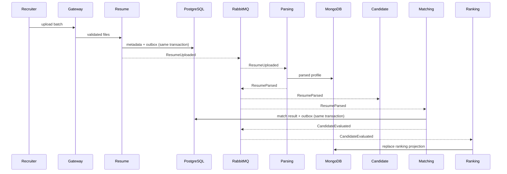

# RabbitMQ event flow

The durable topic exchange is `talentlens.events.v1`. Every event carries `event_id`, `event_type`, `event_version`, UTC `occurred_at`, optional `correlation_id`, and a typed-by-convention payload. Messages are persistent and include the event ID as the broker message ID.

Queues are durable and persistent; consumers acknowledge only after the callback returns, retry callback exceptions up to three times with short backoff, and dead-letter repeated failures to a durable `.dead` queue. Consumers use event IDs for idempotency where database records are mutated. Correlation IDs are copied from the HTTP request into outbox events and forwarded on gateway calls. Retry timing and DLQ inspection should be expanded for production operations.

Key payloads contain IDs and storage references for uploads; PDF/DOCX bytes are never placed on RabbitMQ.
